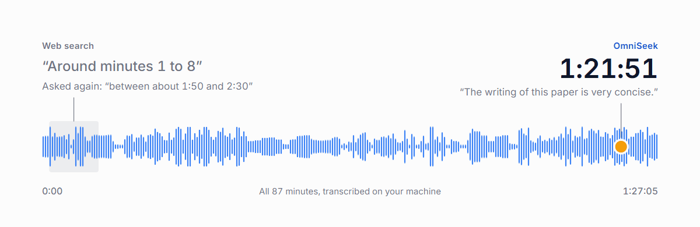
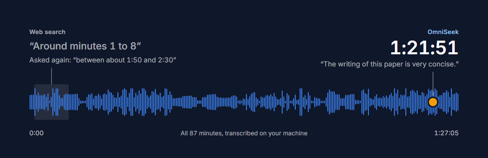

<!-- mcp-name: io.github.Battam1111/omniseek -->

<p align="center">
  
</p>

**Give your AI agent the parts of the internet web search doesn't reach.**

OmniSeek is an add-on for AI assistants and agents like Claude Code, Cursor, and Codex that lets them search where web search stops.

- Ask in English, get what people actually said on Bilibili, and Zhihu when you ask for it, with links to the original posts.
- Get the papers a research field is built on, and the recent ones building on them, in one answer.
- Have your agent watch a topic and tell you only what is new since last time.

```bash
uv tool install omniseek
claude mcp add omniseek -- omniseek
```

Runs on your own computer. It plugs in through MCP, the standard way AI apps like Claude Code and Cursor add tools. Cursor and Codex: one line each, see [Install](https://github.com/Battam1111/omniseek/blob/main/docs/install.md#connect-your-client).

[](https://github.com/Battam1111/omniseek/actions/workflows/ci.yml) [](https://pypi.org/project/omniseek/) [](https://github.com/Battam1111/omniseek/blob/main/LICENSE)  
**Languages:** English · [中文](https://github.com/Battam1111/omniseek/blob/main/docs/i18n/README_zh.md) · [日本語](https://github.com/Battam1111/omniseek/blob/main/docs/i18n/README_ja.md)

---

## See the difference

One real question, asked in Chinese: in Mu Li's 87-minute Bilibili walkthrough of the Transformer paper, what does he say about the paper's writing, and at what minute?

<p align="center">
  <a href="https://raw.githubusercontent.com/Battam1111/omniseek/main/assets/demo/seek-en-light.gif?v=2026-11-12#gh-light-mode-only"><picture>
    <source media="(max-width: 480px)" srcset="https://raw.githubusercontent.com/Battam1111/omniseek/main/assets/demo/seek-en-light-narrow.gif?v=2026-11-12#gh-light-mode-only">
    
  </picture></a>
  <a href="https://raw.githubusercontent.com/Battam1111/omniseek/main/assets/demo/seek-en-dark.gif?v=2026-11-12#gh-dark-mode-only"><picture>
    <source media="(max-width: 480px)" srcset="https://raw.githubusercontent.com/Battam1111/omniseek/main/assets/demo/seek-en-dark-narrow.gif?v=2026-11-12#gh-dark-mode-only">
    
  </picture></a>
</p>

- **Web search** answered from other people's notes: "around minutes 1 to 8", and asked again, "between about 1:50 and 2:30". A search for his exact words found nothing.
- **With OmniSeek**, the agent transcribed all 87 minutes locally and found the line at [1:21:51](https://www.bilibili.com/video/BV1pu411o7BE?t=4911): 「这篇文章的写作是非常简洁的，因为就是说他每一句话就基本上在讲一件事情。」 "The writing of this paper is very concise: basically, every sentence says one thing." Asked again, it gave the same line from cache in 0.1 s.

[The full comparison on three questions](https://github.com/Battam1111/omniseek/blob/main/docs/compare.md), with sources, dates, and a short video.

---

## What your agent can reach

- **Chinese communities**: Bilibili videos and comments, Zhihu answers when you ask for them, recent V2EX threads, all with links to the posts. More: [Bilibili](https://battam1111.github.io/omniseek/bilibili-mcp.html), [Zhihu](https://battam1111.github.io/omniseek/zhihu-mcp.html)
- **Across languages**: ask in English, search in Chinese, answer in English. And the reverse. [More](https://battam1111.github.io/omniseek/cross-lingual-search-mcp.html)
- **Podcasts and videos**: turns speech into text on your own computer and quotes it with the minute (optional add-on). [More](https://battam1111.github.io/omniseek/podcast-transcription-mcp.html)
- **Research papers**: which papers a field is built on and which recent ones cite them. [More](https://battam1111.github.io/omniseek/citation-graph-mcp.html)
- **New since last time**: save a search once; each rerun shows only what is new. [More](https://battam1111.github.io/omniseek/research-monitoring-mcp.html)
- **Sites you log in to**: if you switch it on, your agent reads them through your own browser login. Off by default. [More](https://github.com/Battam1111/omniseek/blob/main/docs/walled-sources.md)

It also keeps what it finds in a local index on your computer, so later searches start from what it already knows.

---

## Install

The two commands above are all you need, with Python 3.11 or newer ([uv](https://docs.astral.sh/uv/) installs it if you don't have it). Your AI app starts OmniSeek when it needs it. Nothing to keep running, no port to open.

Cursor, Codex, pipx, Docker, and the optional add-ons (podcast transcription, PDF reading, sites you log in to) are in **[Install](https://github.com/Battam1111/omniseek/blob/main/docs/install.md)**.

---

## Your data, your logins

OmniSeek runs on your computer. There is no OmniSeek cloud, no account, no telemetry: your agent's searches go straight to the sites you turned on. Public sites are on by default. Sites that need a login are off until you switch them on, and then they use the login already in your own browser; OmniSeek never sees your password. What it builds up as you use it stays in local files you own.

OmniSeek has no AI model of its own and sends nothing to a server of ours. Your agent does the thinking; OmniSeek goes and gets things. Settings: [Configuration](https://github.com/Battam1111/omniseek/blob/main/docs/configuration.md).

---

## Tools

Your agent starts with `omniseek_search`; `omniseek_sources` shows what is available. The rest, from paper maps to saved searches and the notes your agent keeps (`omniseek_ruling`, `omniseek_statement`):

| Tool | What it does |
|------|-------------|
| `omniseek_search` | Search the whole catalog at once, remove duplicates, rank. Works across languages. |
| `omniseek_read` | Turn any URL or document (web page, PDF, arXiv) into clean text. |
| `omniseek_view` | Look at images, document figures, and video frames. |
| `omniseek_transcribe` | Transcribe audio or video locally, English and Chinese, from any timestamp. |
| `omniseek_field_skeleton` | Map a research field's citations: the papers it is built on and the recent ones. |
| `omniseek_resolve_identity` | Match a person's name to candidate author IDs across databases. |
| `omniseek_coauthors` | Map a researcher's collaborators by number of joint papers. |
| `omniseek_institution_cohort` | List who actively publishes at a lab, within a field. |
| `omniseek_paper_enrich` | Open-access PDF, retraction status, and citation count for a paper. |
| `omniseek_paper_recommend` | Similar papers (SPECTER embeddings) that keyword search misses. |
| `omniseek_graph` | Query the local graph of what OmniSeek has found: find, neighborhood, between, since, similar. |
| `omniseek_sensor` | Saved searches that rerun on a schedule and report only what is new. |
| `omniseek_ruling` | Record that two entries are (or are not) the same person or thing. |
| `omniseek_statement` | Record a directed relation between two entries. |
| `omniseek_curator_act` | Propose, test, add, or retire a source. |
| `omniseek_curator_view` | Read the queue of proposed sources or one source's report. |
| `omniseek_gather` | Run several tools in parallel, one response. |
| `omniseek_sources` | List sources by domain, region, capability, and health. |

One MCP prompt comes with them: `investigate(target, shape, context)`, a ready-made investigation recipe, where `shape` is `person`, `lab`, `field`, `product` or `chase` and the optional `context` narrows the angle.

Every parameter, and what each returned field means: **[TOOLS.md](https://github.com/Battam1111/omniseek/blob/main/docs/TOOLS.md)**. Each tool's own description ends by pointing at its section there.

---

## More

[Worked examples, real outputs](https://github.com/Battam1111/omniseek/blob/main/docs/examples.md) · [A full case study](https://github.com/Battam1111/omniseek/blob/main/docs/case-study.md) · [FAQ](https://github.com/Battam1111/omniseek/blob/main/docs/faq.md), including how it differs from Exa and Tavily · [All sources](https://github.com/Battam1111/omniseek/blob/main/docs/sources.md) · [Source health, updated weekly](https://github.com/Battam1111/omniseek/blob/health-data/README.md)

**[How we test these claims](https://github.com/Battam1111/omniseek/blob/main/bench/DESIGN.md)**: a test only counts if we first checked that plain web search could not find its answer on the first page ([latest results](https://github.com/Battam1111/omniseek/blob/health-data/bench/RESULTS.md)). Using Claude Code? [`skills/omniseek-investigate`](https://github.com/Battam1111/omniseek/blob/main/skills/omniseek-investigate/SKILL.md) is a ready-made research method: search wide, narrow in, add structure.

---

## Contributing

See [CONTRIBUTING.md](https://github.com/Battam1111/omniseek/blob/main/.github/CONTRIBUTING.md): a new source has to find something plain web search doesn't. Fixing a source that stopped working is always welcome.

By participating you agree to the [Code of Conduct](https://github.com/Battam1111/omniseek/blob/main/.github/CODE_OF_CONDUCT.md).

<div align="center">

---

**Give your AI agent the parts of the internet web search doesn't reach.**

[Apache-2.0](https://github.com/Battam1111/omniseek/blob/main/LICENSE) · [NOTICE](https://github.com/Battam1111/omniseek/blob/main/NOTICE) · [Security](https://github.com/Battam1111/omniseek/blob/main/.github/SECURITY.md) · [Cite](https://github.com/Battam1111/omniseek/blob/main/CITATION.cff)

</div>
