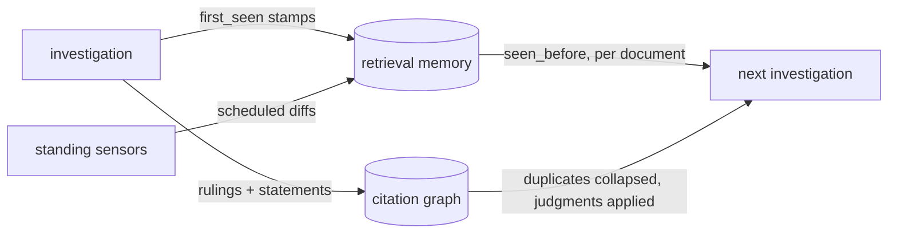

# Case study: the second investigation

<sub>[OmniSeek](../README.md)&nbsp;·&nbsp;[Worked examples](examples.md)&nbsp;·&nbsp;[Tools](tools.md)&nbsp;·&nbsp;[The source catalog](sources.md)</sub>

Search is stateless: ask the same question twice and it starts from zero twice. This case
study is about the other half of OmniSeek, the half that compounds. One real session
(2026-08-16), one working instrument that has been in daily use for weeks; every block below
is a verbatim output from that session, trimmed for the page. The question we handed the
agent is an ordinary one: map where credit assignment for multi-agent LLM systems stands
this week. What matters is not the topic. It is what OmniSeek already knew.

This is the second investigation in that loop: the first populated retrieval memory and the
citation graph, and this one shows how the next investigation starts from those records.

## One call, one ranked list, and a paper trail

```python
omniseek_search("credit assignment in multi-agent LLM systems", limit=8)
```

```json
"_meta": {
  "searched": 87,
  "elapsed_s": 11.0,
  "deduped": { "in": 435, "out": 8 },
  "index": { "lexical": 50, "vector": 50, "mode": "hybrid" }
}
```

Here `lexical` and `vector` are candidate counts, not scores or percentages. For this
`limit=8` call, the recall arm uses the `k=max(50, 4 * limit)` rule in
`src/omniseek/core/fetcher.py`, so each arm contributes up to 50 candidates.

The `searched: 87` value is 87 of the configured sources eligible for this broad pass, not
87 of the full catalog. `src/omniseek/core/fetcher.py` sets it to `len(target_sources)` after
routing removes sources that run only when named, plus disabled, retired, and watchdog-down sources.

Eleven seconds, 87 eligible sources in parallel, 435 candidate records collapsed into 8 documents.
Not eight links: eight distinct claims on the field, because records of the same paper from
different indexes merge into one document that lists who corroborates it. And the ranking is
fused from two recalls, live lexical hits plus the local vector index, so a paraphrase with
no shared words still surfaces.

## OmniSeek recognized every result

All eight documents came back already stamped. Here is one, trimmed to the stamp:

```json
{
  "title": "Proximity-Based Multi-Turn Optimization: Practical Credit Assignment for LLM Agent Training",
  "source": "semantic_scholar",
  "metadata": {
    "also_in": ["crossref"],
    "corroboration": 2,
    "seen_before": true,
    "first_seen_at": "2026-07-03T12:27:09.662504+00:00"
  }
}
```

`corroboration: 2` counts distinct backends, while `also_in` lists additional source names
beyond the surviving document. One additional source name can therefore represent the second
independent backend without the two fields being contradictory.

This instance first perceived that paper on July 3. Six weeks later, "is this new to us?" is
not something the agent estimates from vibes; it is a per-document fact with a timestamp. A
fresh install starts empty. This is what the same install feels like after six weeks of
ordinary use: nothing you have already seen gets to pretend it is news.

## Two indexes disagree about the same paper, out loud

```json
"conflicts": [{
  "topic": "citations",
  "source_a": "crossref",        "claim_a": "citations=0.0 ()",
  "source_b": "semantic_scholar", "claim_b": "citations=22.0 ()",
  "ratio": "inf"
}]
```

The empty parentheses in the two citation claims are the formatter's explicit placeholder for
a missing source unit. They do not mean the citation values are missing.

One index says that paper has never been cited; another counts 22. OmniSeek does not average
the two into a fake number and does not silently pick a winner. The disagreement is handed
over as data, ratio included, and the agent judges it (here: one index simply lags
arXiv-first papers). A single confident number would have been wrong; a visible conflict is
information.

## What it did not search, it says

```json
"source_diversity": { "absent_perspectives": ["audio", "news", "walled"] },
"excluded_relevant": [{
  "name": "agent_tooling_radar",
  "reason": "tooling/skill radar; watchtower + named only, kept out of research search",
  "why": "relevant but excluded; re-run naming it: sources=['agent_tooling_radar']"
}]
```

`absent_perspectives` is computed from the closed set `academic`, `social`, `audio`, `walled`,
and `news` in `src/omniseek/core/fetcher.py`; it reports which of those fixed perspectives did
not appear in this pass.

(`agent_tooling_radar` is a monitor source that runs only when named; its `reason` field is quoted as
stored on the day of this session. The catalog has since reworded that entry in plainer
language; outputs here stay verbatim to their run.) A ranked list that merely looks complete is the most dangerous
kind of complete. So the router reports which perspectives this pass had none of, and which
deliberately-excluded sources matched the query anyway, each with the exact parameter that
reaches it. Coverage becomes something you read, not something you assume.

## A judgment, recorded once, inherited forever

The citation graph held two nodes with the same title, "Quantile Credit Assignment". Two
`omniseek_read` calls settled it: same ICML 2023 paper, same authors, same abstract; one node
is the conference record, the other the same paper as imported from DBLP, the computer-science
bibliography. So the agent ruled (a node id is the graph's name for a remembered document:
source key plus that source's own id):

```python
omniseek_ruling(action="create",
                src="doc:mlrc:4yoLVter71", dst="doc:mlrc:vB9mHaHaHH", verdict="same")
```

```json
{ "created": true, "ruling": {
    "verdict": "same",
    "note": "same ICML 2023 paper (Mesnard et al., Quantile Credit Assignment): the conference record and the DBLP import of the same forum",
    "ruled_at": "2026-08-16T11:11:48.070749+00:00" } }
```

From now on, the graph's default working view collapses those two nodes into one. The ruling
is attributed, dated, and reversible, and the division of labor is strict: OmniSeek never
decides that two things are the same. It stores what the agent concluded and applies it at
read time.

## Stand a watch

```python
omniseek_sensor(action="create",
                query="credit assignment for multi-agent LLM systems", schedule="weekly")
```

The first manual run returned `"total_results": 15, "new_count": 15`: a fresh baseline, where
everything is new exactly once. From then on the sensor diffs mechanically and speaks only
when something changed. [Worked examples](examples.md) shows the same shape settling in: 15
new on day one, 3 the next day, then 0, which is exactly what a working watch looks like.

## The loop



Every investigation leaves OmniSeek sharper than it found it: stamps in the retrieval
memory, judgments in the citation graph, watches on the frontier. The second investigation
does not start from zero. It starts from everything the first one settled.

## What OmniSeek did not do

It never summarized. It never decided which paper matters; the agent did. It reached,
stamped, collapsed, contradicted, and remembered, and the thinking stayed in the agent from
start to finish. Nothing that can hallucinate ever touched the data.

## One question, three layers

A second real run, on a different topic: the 2026 F-1 student visa rule. The answer sat in three
layers, and each one opened a different way.

<div align="center">
  <picture>
    <source media="(prefers-color-scheme: dark)" srcset="https://raw.githubusercontent.com/Battam1111/omniseek/main/assets/demo-en-dark.png?v=2026-10-11">
    
  </picture>
</div>

What each layer gave back, verbatim:

- **Written down, and easy to find.** Headlines, official FAQ, top blogs, all one voice: *"From 2026, F-1 admission is limited to a 4-year initial period; renewal in a third country remains possible."* All quote the same rule. None of them had been through it.
- **Written down, but behind a login.** Three first-person threads on 1point3acres, read through your own login: **Bangkok**, booked to passport in 25 days, interview to approval in 30 minutes; **Milan**, a month-long fight for a slot, visa issued for 5 years; **Tokyo**, *"silky-smooth"*. Under the Milan post the author comes back in the comments: *"Book any late slot first, then email the consulate to expedite. For one F-1 applicant it worked."* One person's experience, not official guidance.
- **Never written down.** A Chinese explainer video on bilibili, transcribed locally: the *"4-year cap"* in the headlines is the initial period, extensions moved desks rather than vanishing. A rednote video note whose caption is four hashtags, frames and speech read locally: a 212(a)(6)(C) refusal abroad, a misrepresentation finding, can nearly close the F-1 road.

Plain search quoted the rule and stopped. The people who had lived it held the timelines, the
workaround, and the risk. It also listed the places it had not searched yet, and how to search
each one.

Reproducing the second and third layers needs the optional add-ons: your own 1point3acres and
rednote logins ([Sites behind a login](walled-sources.md)) and transcription
([Install](install.md#podcast-and-video-transcription)).

<details>
<summary>中文版</summary>

<div align="center">
  <picture>
    <source media="(prefers-color-scheme: dark)" srcset="https://raw.githubusercontent.com/Battam1111/omniseek/main/assets/demo-zh-dark.png?v=2026-10-11">
    
  </picture>
</div>

每一层带回了什么，逐字引用：

- **搜得到。** 新闻头条、官方 FAQ、热门博客，口径完全一致：*「2026 年起，F-1 入境限四年初始期；第三国续签仍被允许。」* 引的都是同一条规则，谁都没真的办过。
- **写下来了，但要登录。** 一亩三分地上三份第一手时间线，用你自己的登录态读到：**曼谷**，预约到拿护照 25 天，面签到通过 30 分钟；**米兰**，抢号一个月，签出 5 年；**东京**，*「丝滑」*。米兰帖下，楼主回到评论区补充：*「先约一个靠后的日期，再发邮件给领事馆申请加急。有一位 F-1 申请人真的成功了。」* 个人经验，非官方指引。
- **压根不是文字。** bilibili 上一段中文解读视频，本地转写：头条说的<em>「最多待 4 年」</em>其实是初始停留期，延期只是换了审批部门，并没有消失。小红书一条视频笔记，正文只有四个话题标签，画面与语音在本地读取：第三国遇上 212(a)(6)(C) 拒签（虚假陈述认定），F-1 之路几乎断送。

普通搜索引到规则就停了。真正办过的人手里有时间线、办法和风险。它还列出了还没去搜的地方，以及各自怎么搜。

</details>

<details>
<summary>日本語版</summary>

<div align="center">
  <picture>
    <source media="(prefers-color-scheme: dark)" srcset="https://raw.githubusercontent.com/Battam1111/omniseek/main/assets/demo-ja-dark.png?v=2026-10-11">
    
  </picture>
</div>

各層が持ち帰ったもの、原文のまま:

- **書かれていて、届く。** ニュース見出し、公式 FAQ、人気ブログ、声はひとつ:*「2026 年より F-1 の入国は 4 年の初期滞在期間に制限。第三国での更新は引き続き可能。」* どれも同じ規則の引用で、実際に経験した人はいない。
- **書かれてはいるが、ログインの向こう。** 1point3acres の一次体験タイムライン三件、あなた自身のログインで読んだもの:**バンコク**、予約からパスポートまで 25 日、面接から承認まで 30 分。**ミラノ**、枠争奪ひと月、ビザは 5 年。**東京**、*「スムーズそのもの」*。ミラノ投稿のコメント欄には投稿者が戻ってきて:*「まず遅い日程で予約し、それから領事館にメールで繰り上げを依頼。F-1 申請者一人は実際に成功した。」* 個人の経験であって、公式の案内ではない。
- **そもそも文字ではない。** bilibili の中国語解説動画をローカルで書き起こし:見出しの<em>「最長 4 年」</em>は初期滞在期間のことで、延長は審査窓口が変わっただけで消えてはいない。RED（小紅書）の動画ノートは本文がハッシュタグ四つだけ、フレームと音声をローカルで読む:第三国での 212(a)(6)(C) 拒否(虚偽陳述の認定)は F-1 への道をほぼ閉ざす。

通常の検索は規則を引用して止まりました。実際に経験した人々はタイムラインと回避策とリスクを持っていました。まだ検索していない場所と、それぞれの検索のしかたも挙げていました。

</details>

---

<div align="center"><sub><a href="../README.md">← back to the README</a></sub></div>
