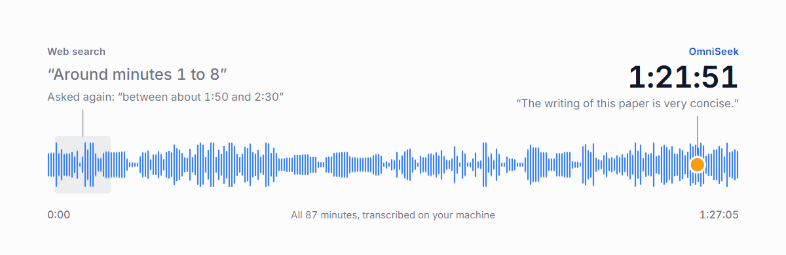

<!-- mcp-name: io.github.Battam1111/omniseek -->
<!-- Generated from README.md by scripts/gen_pypi_readme.py: edit README.md, then run it. -->

<p align="center">
  
</p>

**Give your AI agent the parts of the internet web search doesn't reach.**

OmniSeek is an add-on for AI assistants and agents like Claude Code, Cursor, and Codex that lets them search where web search stops.

- Ask in English, get what people actually said on Bilibili, and Zhihu when you ask for it, with links to the original posts.
- Get the papers a research field is built on, and the recent ones building on them, in one answer.
- Have your agent watch a topic and tell you only what is new since last time.

```bash
uv tool install omniseek
claude mcp add omniseek -- omniseek
```

Runs on your own computer. It plugs in through MCP, the standard way AI apps like Claude Code and Cursor add tools. Cursor and Codex: one line each, see [Install](https://github.com/Battam1111/omniseek/blob/main/docs/install.md#connect-your-client).

[](https://github.com/Battam1111/omniseek/actions/workflows/ci.yml) [](https://pypi.org/project/omniseek/) [](https://github.com/Battam1111/omniseek/blob/main/LICENSE)  
**Languages:** English · [中文](https://github.com/Battam1111/omniseek/blob/main/docs/i18n/README_zh.md) · [日本語](https://github.com/Battam1111/omniseek/blob/main/docs/i18n/README_ja.md)

---

## See the difference

One real question, asked in Chinese: in Mu Li's 87-minute Bilibili walkthrough of the Transformer paper, what does he say about the paper's writing, and at what minute?

<p align="center">
  
</p>

- **Web search** answered from other people's notes: "around minutes 1 to 8", and asked again, "between about 1:50 and 2:30". A search for his exact words found nothing.
- **With OmniSeek**, the agent transcribed all 87 minutes locally and found the line at [1:21:51](https://www.bilibili.com/video/BV1pu411o7BE?t=4911): 「这篇文章的写作是非常简洁的，因为就是说他每一句话就基本上在讲一件事情。」 "The writing of this paper is very concise: basically, every sentence says one thing." Asked again, it gave the same line from cache in 0.1 s.

[The full comparison on three questions](https://github.com/Battam1111/omniseek/blob/main/docs/compare.md), with sources, dates, and a short video.
